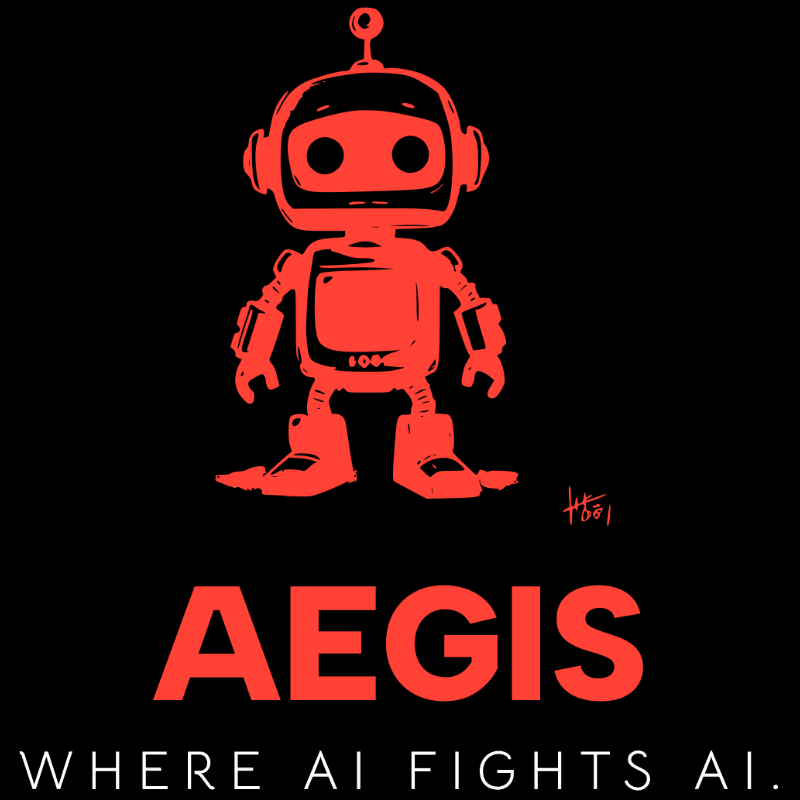
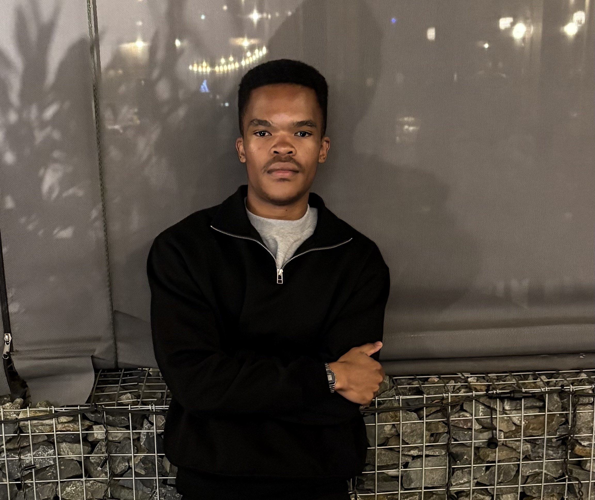
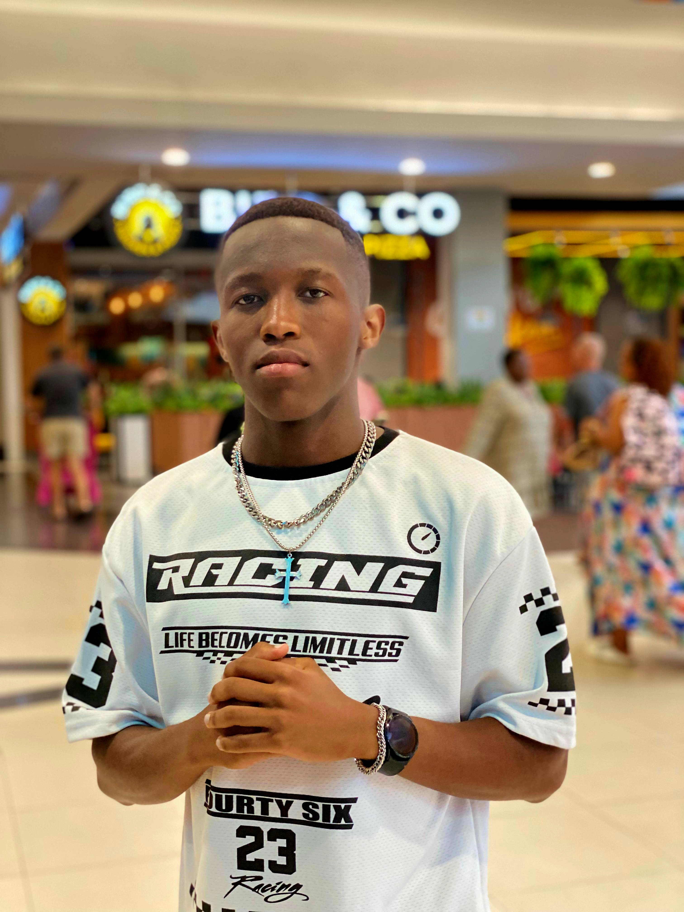
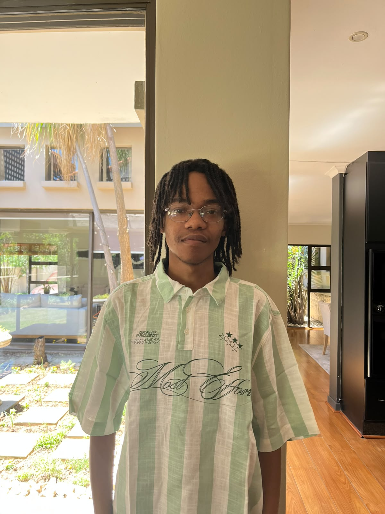

# AEGIS - Adversarial Evaluation Genuineness Intelligence System
## THE ALCHEMISTS

  

 

---

## Project Aim

AEGIS is a recruitment technical assessment integrity platform designed to help recruiters evaluate whether assessment performance genuinely represents a candidate's own skills. We combine adversarial question generation with behavioural telemetry, analytics, and reporting to identify patterns that may require further human review. Our system doesn't automatically accuse candidates of misconduct; instead, it provides recruiters with explainable review-priority signals and evidence that they can investigate.
---

# Documentation

## Requirements Specifications
- [Software Requirements Specification](docs/Demo2/SRS.md)
- [Software Architecture Specification](docs/Demo2/SAS.md)
- [Service Contracts](docs/Demo3/Service%20Contract.pdf)

---

## Deployment Link & Docs
- [Deployment Link](https://aegis-cos301.vercel.app/)
- [Deployment Documentation PDFS](docs/Demo3/Deployment.pdf)

---
## NON FUNCTIONAL REQUIREMENTS
- [NON-FUNCTIONAL-REQUIREMENTS](docs/Demo2/pdfs/NON%20FUNCTIONAL%20REQUIREMENTS.pdf)
- [NFR TRACEABILITY MATRIX](docs/Demo3/NFR%20MATRIX.pdf)
---

## Brand Style Guide
- [Brand Style Guide PDF](docs/Demo2/pdfs/AEGIS%20Brand%20Style%20Guide%20v3.0.pdf)

---

## Coding Standards
- [Coding Standards PDF](docs/Demo2/pdfs/Coding%20Standards.pdf)

---

## User Manual Documentation
- [User Manual PDF](docs/AEGIS-User%20Manual.pdf)

---

## Quality Assurance
- [Testing Policy PDF](docs/Demo2/pdfs/Testing%20Policy.pdf)

---

# GitHub Project Board

- [AEGIS Project Board] (https://github.com/orgs/COS301-SE-2026/projects/59/views/1)
    
---

# Team Members

## Kutlwano Tau

**Role:** Team Lead & Backend Developer 

**Profile description:**
Final-year Computer Science student at University of Pretoria with a strong foundation in software development, algorithms, and system design. I have experience building full-stack applications and enjoy working with backend technologies.
I enjoy solving problems, learning new technologies, and applying computer science concepts to real-world projects.

**LinkedIn:** (https://www.linkedin.com/in/kutlwano-tau-b25983244)

**CV:** [View CV](docs/ProjectDay/KutlwanoTau-CV.pdf)

**Email:** (kayteetau@icloud.com)

---

## Sambulo Zikhali

**Role:** Backend Developer, Frontend Developer, Data Engineer

**Profile description:**
I am a passionate Full Stack Developer experienced in building end to end web applications using modern technologies like Next.js, React, and TypeScript. I enjoy bridging the gap between robust, scalable backend architectures and intuitive, user centric frontends. Whether it's implementing real time, dynamic UI development or designing secure APIs, I am driven by the challenge of creating seamless digital experiences. I pride myself on writing clean, maintainable code and continuously exploring new ways to refine my craft across the entire stack.

**LinkedIn:** (https://www.linkedin.com/in/sambulo-zikhali-468669261)

**CV:** [View CV](docs/ProjectDay/Sambulo%20ZIkhali%20CV.pdf)

**Email:** (sambulozikhali2204@gmail.com)

---

## Luyanda Ndlovu

**Role:** Frontend & DevOps

**Profile description:**
I'm a student in the BSc Information & Knowledge Systems program studying software engineering, and I'm interested in web design and front-end programming.
I obtained hands-on experience creating real-world apps by creating a full-stack version control solution for the IMY220 module. My passion for designing intuitive and eye-catching user interfaces was ignited by this encounter.
I like to create cutting-edge, useful applications by fusing the logical side of programming with the artistic side of design, and I'm constantly trying to get better at what I do.

**LinkedIn:** (https://www.linkedin.com/in/luyanda-ndlovu-02a281375)

**CV:** [View CV](docs/ProjectDay/CV%20-%20Luyanda%20Ndlovu.pdf)

**Email:** (luyanda.ndlovu@icloud.com)

---

## Myron Wheeler

**Role:** Backend Developer & AI research 

**Profile description:**
Final-year Computer Science student at the University of Pretoria currently interning at Korridor, with industry experience focused on database systems and data-driven development. I enjoy building efficient, reliable solutions and have a strong interest in frontend development and creating intuitive user experiences.
What I enjoy most about software development is the rewarding process of solving difficult problems and finally fixing issues that have been challenging for a long time. I am passionate about continuously improving my technical skills and applying them to real-world projects.

**LinkedIn:** (https://www.linkedin.com/in/myron-wheeler-8b5847233)

**CV:** [View CV](frontend/public/mtt/Myron_Wheeler_CV.pdf)

**Email:** (myronwheeler@outlook.com)

---

## Lusanda Mtembu

**Role:** Frontend Developer  

**Profile description:**
Final-year Computer Science student at the University of Pretoria with experience in backend & frontend development having built reliable, well-structured systems. I enjoy working on projects that have real-world impact and am currently exploring the intersection of AI and security through my capstone project. Always looking to learn, contribute, and grow through meaningful technical challenge

**LinkedIn:** (https://www.linkedin.com/in/lusanda-mtembu-aa0938247/)

**CV:** [View CV](frontend/public/mtt/Lusanda-Mtembu.pdf)

**Email:** (lubandamte@gmail.com)
